# Deploying Applications via ArgoCD UI (Imperative Approach)

This guide demonstrates how to deploy a Kubernetes application using the **ArgoCD Web User Interface (UI)**. We will deploy a standard NGINX workload (Deployment + Service) to examine how ArgoCD manages state and synchronizes resources from the dashboard.

---

## 💡 Overview & Concepts

- **Imperative Application Management:** In the UI approach, applications are defined directly through the ArgoCD dashboard.
- **Cluster-bound Metadata:** ArgoCD creates the `Application` Custom Resource Definition (CRD) directly within the Kubernetes cluster. The application definition itself resides **only in the cluster**, not version-controlled in Git.
- **Use Cases:** This method provides a quick visual workflow for testing, local development, and learning.

> ℹ️ **Note on Best Practices:** While the UI approach is effective for exploration, production environments should adopt the **Declarative Approach** (defining `Application` CRDs inside Git repositories) to ensure true GitOps compliance and auditability.

---

## 📋 Prerequisites

Ensure your local environment meets the following requirements before proceeding:

1. A running **Kind cluster**
2. **ArgoCD installed** and operational (via Helm or raw manifests)
3. **ArgoCD CLI** installed and authenticated
4. **`kubectl` CLI** configured to target your cluster

> Refer to the setup guide if needed: [ArgoCD Setup & Installation](../../../03_setup_installation/README.md)

---

## 📂 Repository Layout

Navigate to the sample application directory in your cloned repository:

```bash
cd argocd-demos/ui_approach/nginx
```

**Directory Structure:**

```text
ui_approach/nginx
├── nginx_deployment.yml
└── nginx_svc.yml
```

---

## 🚀 Step-by-Step Deployment Guide

### Step 1: Access the ArgoCD Web UI

1. Expose the ArgoCD server locally via port forwarding:

   ```bash
   kubectl port-forward svc/argocd-server -n argocd 8080:443 --address=0.0.0.0 &
   ```

2. Open your browser and navigate to:  
   `http://<instance_public_ip>:8080`

3. Retrieve the default initial admin password and log in:
   - **Username:** `admin`
   - **Password:**
     ```bash
     kubectl -n argocd get secret argocd-initial-admin-secret -o jsonpath="{.data.password}" | base64 -d
     ```

---

### Step 2: Register your Git Repository

1. Navigate to **Settings → Repositories** in the ArgoCD sidebar.
2. Click **Connect Repo**.
3. Select **HTTPS** as the connection method.
4. Provide the repository details:
   - **Project:** `default`
   - **Repository URL:** `<URL_OF_YOUR_FORKED_ARGOCD_DEMOS_REPO>`
   - **Credentials:** (Provide username/token if using a private repository)
5. Click **Connect**.

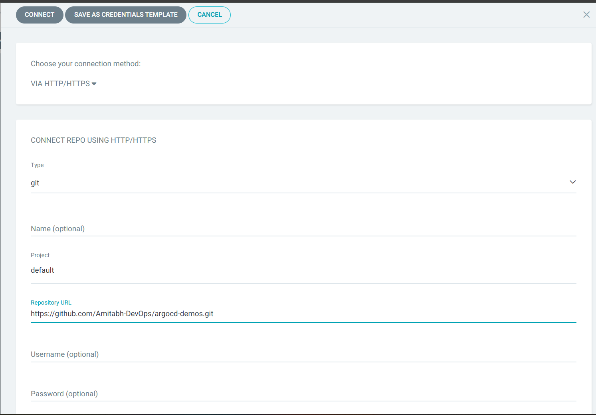

Verify that your repository displays a `Successful` connection status under **Connected Repositories**.

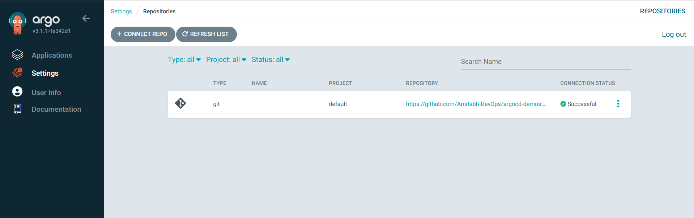

---

### Step 3: Register the Kubernetes Cluster

1. List your available `kubectl` context names:

   ```bash
   kubectl config get-contexts
   ```

2. Add your target cluster context to ArgoCD:

   ```bash
   argocd cluster add kind-argocd-cluster --name argocd-cluster --insecure
   ```

3. Confirm cluster registration:

   ```bash
   argocd cluster list
   ```

   > **Note:** The status may initially display as `Unknown`. The status will update to `Successful` after your first application deployment.

   ```text
   SERVER                          NAME            VERSION  STATUS      MESSAGE                                                  PROJECT
   https://172.31.19.178:33893     argocd-cluster  1.33     Successful
   https://kubernetes.default.svc  in-cluster               Unknown     Cluster has no applications and is not being monitored. 
   ```

Verify the entry in the UI under **Settings → Clusters**.

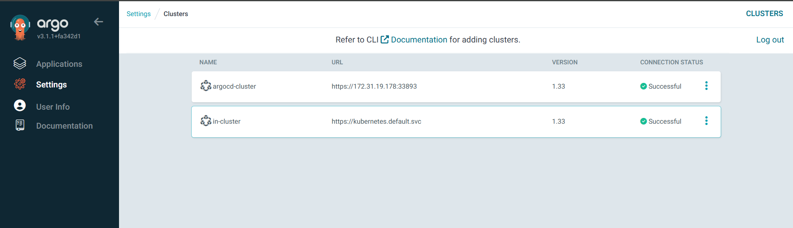

---

### Step 4: Create the Application via UI

1. Navigate to **Applications** and click **New App**.
2. Configure the application details:

   | Field | Value |
   | :--- | :--- |
   | **Application Name** | `nginx-app` |
   | **Project** | `default` |
   | **Sync Policy** | `Manual` |
   | **Repository URL** | Select your registered Git repository |
   | **Revision** | `main` |
   | **Path** | `ui_approach/nginx` |
   | **Cluster URL** | Select your added cluster target |
   | **Namespace** | `default` |

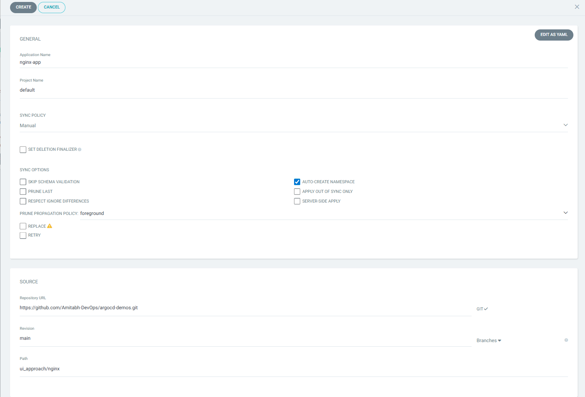
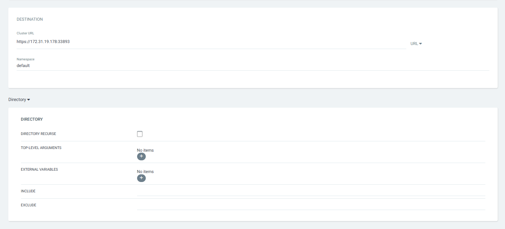

3. Click **Create**.

---

### Step 5: Synchronize the Application

1. Upon creation, the application status will show as **OutOfSync**.

   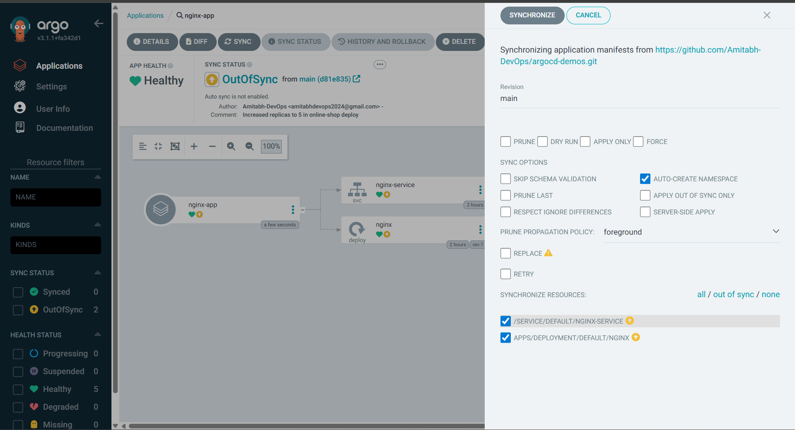

2. Click **Sync** → **Synchronize**.
3. ArgoCD will apply `nginx_deployment.yml` and `nginx_svc.yml` into the target `default` namespace.
4. Once completed, the status will change to **Synced** and **Healthy**.

   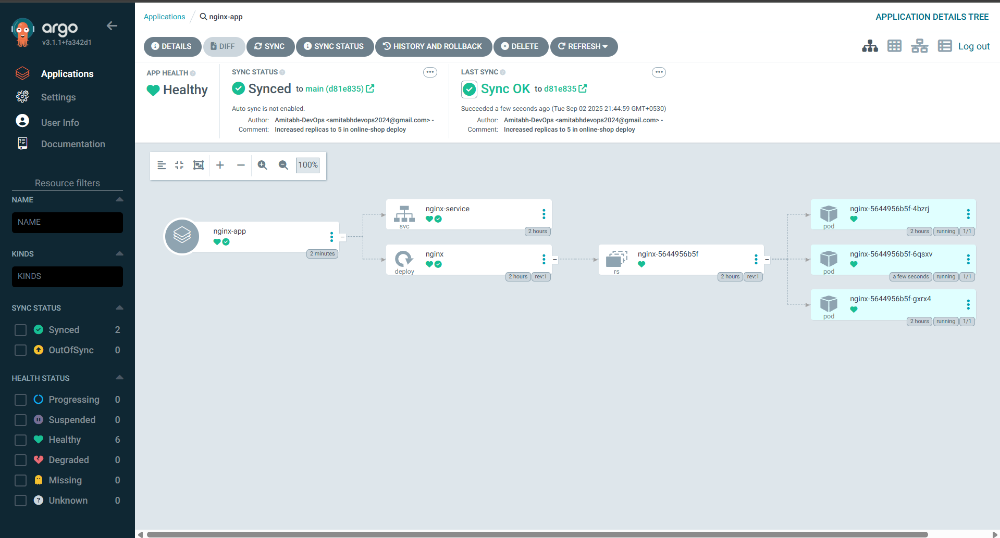

---

### Step 6: Verify Deployment Resources

Check the active workloads using `kubectl`:

```bash
kubectl get pods -n default
kubectl get svc -n default
```

**Expected output:**
- Active NGINX Pods (`nginx-deployment-xxxx`).
- A Service named `nginx-service` targeting port 80.

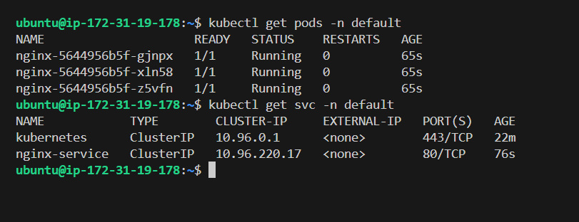

---

### Step 7: Access the Application

1. Port-forward the NGINX service to expose port 8081:

   ```bash
   kubectl port-forward svc/nginx-service 8081:80 --address=0.0.0.0 &
   ```

2. *(If running on cloud infrastructure like AWS EC2)* Ensure your security group allows inbound traffic on port `8081`.

3. Access the application in your browser:  
   `http://<EC2-Public-IP>:8081`

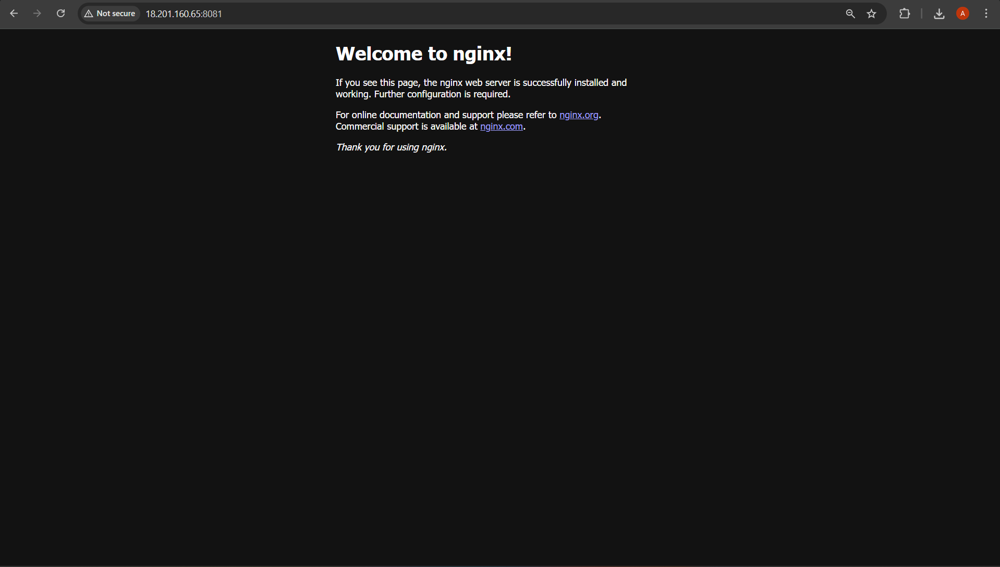

---

## 🧪 Validating GitOps Synchronization

Test how ArgoCD detects and applies configuration drift:

1. Update `nginx_deployment.yml` in your local clone to scale up replicas:

   ```yaml
   spec:
     replicas: 5  # Increased from 3
   ```

2. Commit and push the updated manifest to GitHub:

   ```bash
   git add nginx_deployment.yml
   git commit -m "scale: increase replicas to 5"
   git push origin main
   ```

3. Return to the ArgoCD UI dashboard and open `nginx-app`.
4. Observe that ArgoCD detects the change and marks the application as **OutOfSync**.
5. Click **Sync** → **Synchronize**.
6. Verify the scaled Pods via the CLI:

   ```bash
   kubectl get pods -n default
   ```

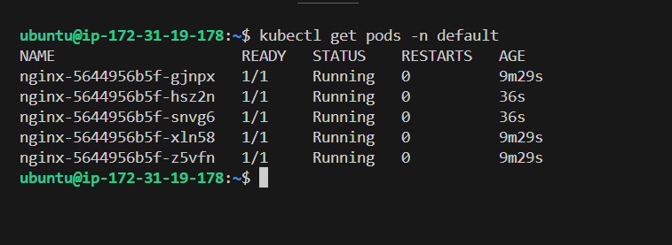

The UI visual tree will update to show 5 running Pod instances:

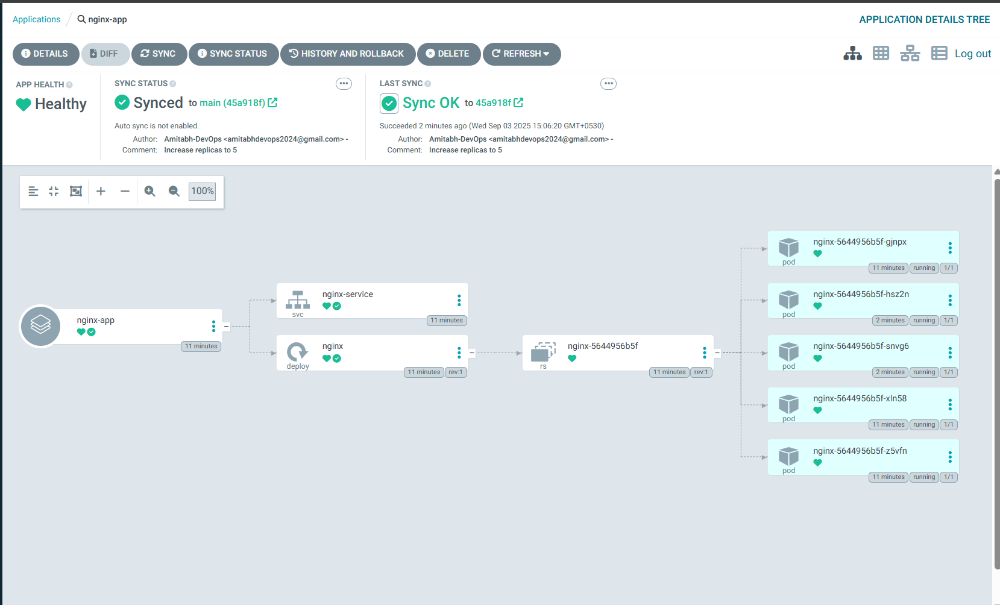

---

## 🧹 Cleanup

To tear down the environment and delete the Kind cluster run:

```bash
kind delete cluster --name argocd-cluster
```

---

## 📌 Key Takeaways

- **Imperative Management:** Configuring applications via the ArgoCD UI is fast, interactive, and well-suited for experimentation.
- **Declarative GitOps Goal:** Production workloads should store both application manifests and ArgoCD `Application` resource definitions directly inside Git repositories to maintain full version control and audit history.