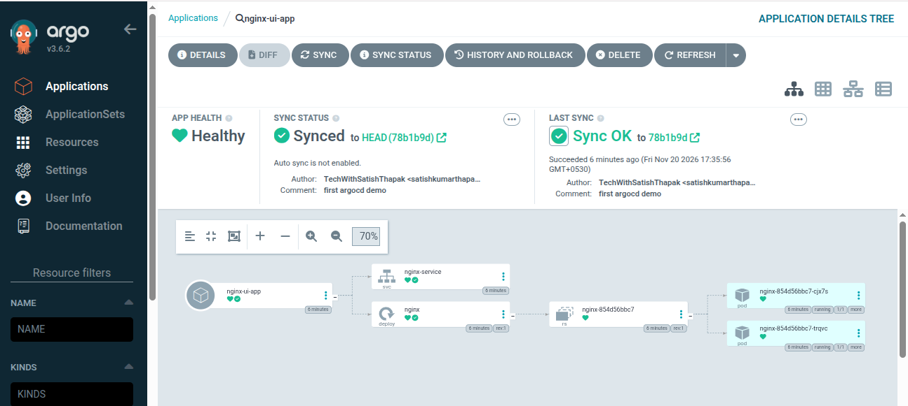
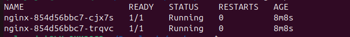
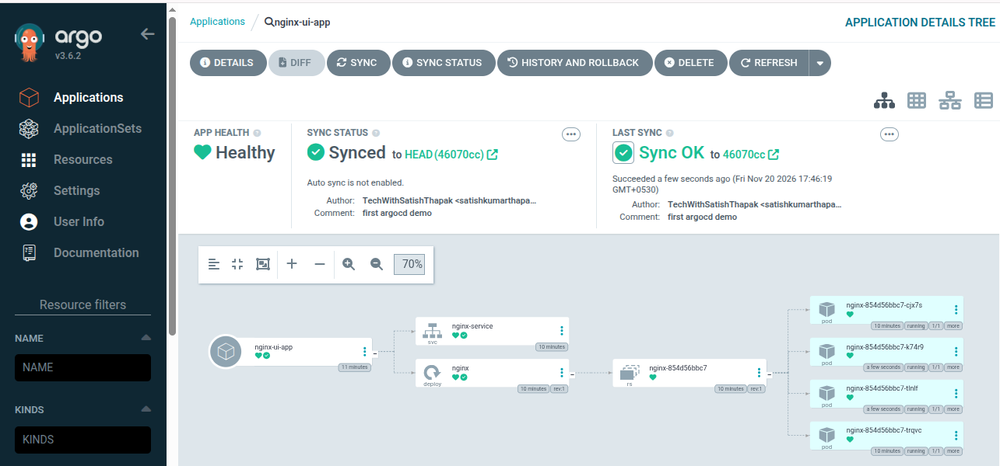
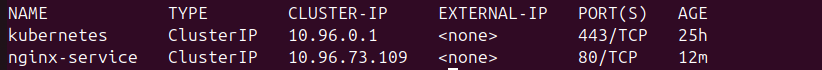

# Deploy First Application Using ArgoCD UI

In this lab, we will deploy an Nginx application to Kubernetes using the ArgoCD Web UI.

This is the first hands-on GitOps deployment where ArgoCD continuously monitors the Git repository and applies the desired state to the Kubernetes cluster.

---

## Objective

Learn how to:

- Create an ArgoCD Application using the UI
- Connect ArgoCD to a Git repository
- Deploy Kubernetes manifests from Git
- Synchronize the desired state with the cluster
- Verify deployment health and sync status

---

## Repository Structure

```text
Day_04_first_app_deployment/
└── ui_approach/
    ├── nginx/
    │   ├── nginx_deployment.yml
    │   ├── nginx_svc.yml
    │   └── README.md
    │
    └── output_images/
        ├── image.png
        ├── nginx_ui_app.png
        ├── pods.png
        ├── replicaset4.png
        └── services.png
```

---

## Architecture

```text
Git Repository
      │
      ▼
 ArgoCD Application
      │
      ▼
 Kubernetes Cluster
      │
      ├── Deployment
      ├── ReplicaSet
      ├── Pods
      └── Service
```

---

## Step 1: Verify ArgoCD Installation

Verify all ArgoCD components are running:

```bash
kubectl get pods -n argocd
```

Expected output:

```bash
argocd-application-controller
argocd-repo-server
argocd-server
```

---

## Step 2: Access ArgoCD UI

Expose the ArgoCD server locally:

```bash
kubectl port-forward svc/argocd-server -n argocd 8080:443
```

Open the browser:

```text
https://localhost:8080
```

---

## Step 3: Login to ArgoCD

Get the initial admin password:

```bash
kubectl get secret argocd-initial-admin-secret \
-n argocd \
-o jsonpath="{.data.password}" | base64 -d
```

Login using:

```text
Username: admin
Password: <decoded-password>
```

---

## Step 4: Create a New Application

Click:

```text
NEW APP
```

Fill the application details.

### General

| Field | Value |
|---------|---------|
| Application Name | nginx-ui-app |
| Project Name | default |
| Sync Policy | Manual |

### Source

| Field | Value |
|---------|---------|
| Repository URL | Your GitHub Repository |
| Revision | HEAD |
| Path | Day_04_first_app_deployment/ui_approach/nginx |

### Destination

| Field | Value |
|---------|---------|
| Cluster URL | https://kubernetes.default.svc |
| Namespace | default |

Click **Create**.

---

## ArgoCD Application

Application created successfully.



---

## Step 5: Synchronize the Application

After creating the application:

```text
Status : OutOfSync
Health : Missing
```

This is expected because ArgoCD has discovered the manifests but has not applied them to the cluster yet.

Click:

```text
SYNC
```

Then click:

```text
SYNCHRONIZE
```

ArgoCD will deploy the resources to Kubernetes.

---

## Step 6: Verify Deployment

Check deployment:

```bash
kubectl get deployment
```

Expected:

```bash
NAME    READY
nginx   2/2
```

---

## Step 7: Verify Pods

List pods:

```bash
kubectl get pods
```

Example:

```bash
nginx-xxxxxx-yyyyy
nginx-xxxxxx-zzzzz
```

Pods created successfully:



---

## Step 8: Verify ReplicaSet

Check ReplicaSets:

```bash
kubectl get rs
```

Example:

```bash
NAME                DESIRED
nginx-5d6d54f5d8    2
```

ReplicaSet created by the deployment:



---

## Step 9: Verify Service

Check service:

```bash
kubectl get svc
```

Expected:

```bash
NAME            TYPE        CLUSTER-IP
nginx-service   ClusterIP
```

Service created successfully:



---

## Step 10: Access Nginx Application

Forward the service locally:

```bash
kubectl port-forward svc/nginx-service 8081:80
```

Open:

```text
http://localhost:8081
```

Expected page:


---

## Verify Application Health

ArgoCD should display:

```text
Sync Status : Synced
Health Status : Healthy
```

This indicates:

- Git repository and cluster are in sync.
- All Kubernetes resources are healthy.
- ArgoCD is successfully managing the application.

---

## Key GitOps Concepts Learned

### Desired State

The desired state is defined in Git.

```text
nginx_deployment.yml
nginx_svc.yml
```

### Current State

The actual state running inside Kubernetes.

### Sync

ArgoCD compares:

```text
Desired State (Git)
           vs
Current State (Cluster)
```

and applies changes when synchronization is triggered.

---

## Summary

In this exercise, we:

✅ Created an ArgoCD Application using the UI

✅ Connected ArgoCD to a Git repository

✅ Deployed Nginx manifests from Git

✅ Synchronized resources to Kubernetes

✅ Verified Deployment, Pods, ReplicaSet, and Service

✅ Accessed the Nginx application

✅ Observed ArgoCD Sync and Health status

This is the foundation of the GitOps workflow using ArgoCD.